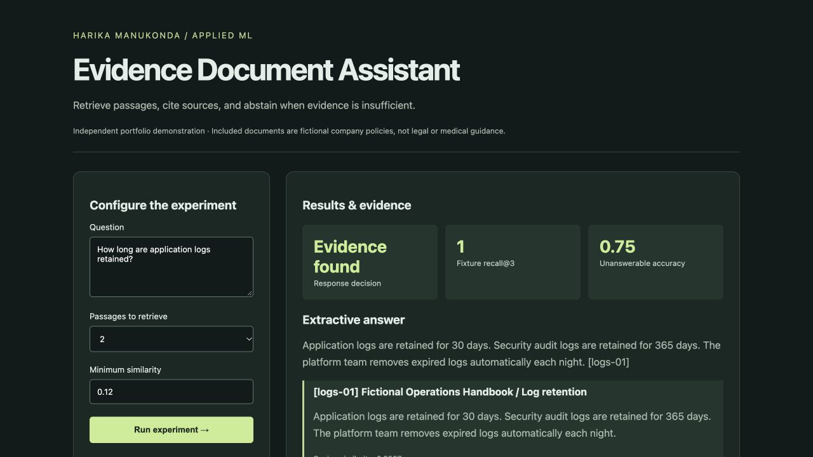
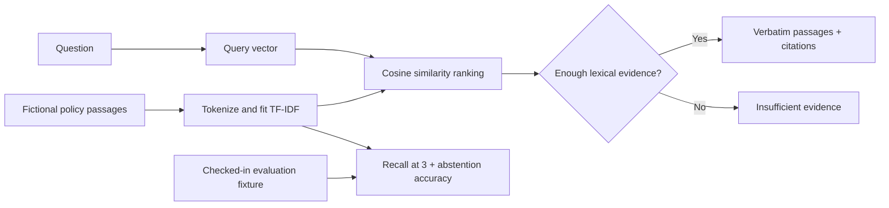

# Evidence Document Assistant

## New: Multimodal Document Intelligence

[Explore the multimodal project](multimodal/README.md): PDF/image ingestion, structured table extraction, actual CLIP visual retrieval, text/hybrid comparisons, and an offline source-page viewer with citations and query-word highlights. [Measured evaluation](reports/multimodal-evaluation.json) · [Evidence viewer HTML](reports/multimodal-evidence.html) (download and open locally).

The original lightweight lexical assistant is documented below.




An evidence-first document search application with TF-IDF retrieval, verbatim source passages, stable citations, and explicit abstention. This version is a fully local **retrieval and extraction baseline**, not a generative LLM application.



## How it works

The index uses smoothed inverse document frequency and L2-normalized term counts. Query vectors use the same vocabulary and IDF weights. Results are ranked by cosine similarity, with deterministic tie ordering. Passages must exceed the configured threshold and have positive similarity. Answers concatenate the actual source text with document IDs, so citations are traceable by construction.

## Evaluation

`data/evaluation.json` has seven answerable and four unanswerable questions. Recall@3 measures retrieval of labeled relevant passages; abstention accuracy measures rejection of the unanswerable subset. The threshold is adjustable. This fixture is small and closely related to the supplied passages; its results are **not** a general-purpose RAG benchmark. Lexical similarity does not guarantee a passage answers a question, and related-vocabulary unanswerable questions can produce false positives.

The next stage is to compare this baseline against dense/hybrid retrieval, add an independently written evaluation set, evaluate answerability separately from similarity, then introduce optional grounded generation and measure citation entailment. No embedding service or LLM API is used in this version.

## Corpus

All six policy passages were written for this demonstration and describe a fictional organization. They are not employer documents or professional policy advice. The corpus is checked in for reproducibility; arbitrary upload and URL fetching are deliberately outside this version's scope.

## Example API request

```sh
curl http://127.0.0.1:8002/api/run -H 'Content-Type: application/json' -d '{"question":"How long are application logs retained?","top_k":2,"threshold":0.12}'
```

## Verification

Tests cover citation/source consistency, unknown vocabulary, threshold behavior, deterministic ranking, invalid input, and duplicate document identifiers.

## Run locally

Requires Python 3.10 or later.

```sh
python3 -m venv .venv
source .venv/bin/activate
python -m pip install -r requirements.txt
python -m unittest discover -s tests -v
python demo.py
python app.py --port 8002
```

Open [the local dashboard](http://127.0.0.1:8002). Submit the form to run an experiment. The dashboard uses no remote fonts, scripts, or API services. `GET /health` provides a liveness check, and `POST /api/run` returns the experiment as JSON. Invalid inputs return HTTP 400.

`python demo.py` reproduces `reports/example.json`. That report contains measured outputs from the checked-in implementation, not hand-written performance claims.

## Containerized experiment

```sh
docker build -t evidence-document-assistant .
docker run --rm evidence-document-assistant
```

The default container runs the reproducible experiment and prints JSON; it does not expose an HTTP port.

## Repository map

- `core.py`: algorithms, validation, and experiment orchestration.
- `app.py`: loopback-only HTTP demo server with bounded request sizes.
- `web/index.html`: interactive dashboard with escaped text rendering.
- `tests/`: behavior and failure-case checks.
- `reports/example.json`: reproducible example output.
- `.github/workflows/checks.yml`: test and demo checks on pushes and pull requests.

## Intended use

Independent educational portfolio project by Harika Manukonda. The local server is a demonstration server, with no authentication or production hardening. Bindings are restricted to loopback. Keep it local; a public deployment requires a production server, access controls where appropriate, request limits, and operational monitoring. Dependency versions are bounded but not lockfile-pinned; cross-version numerical fingerprints may vary slightly.

Licensed under MIT.
