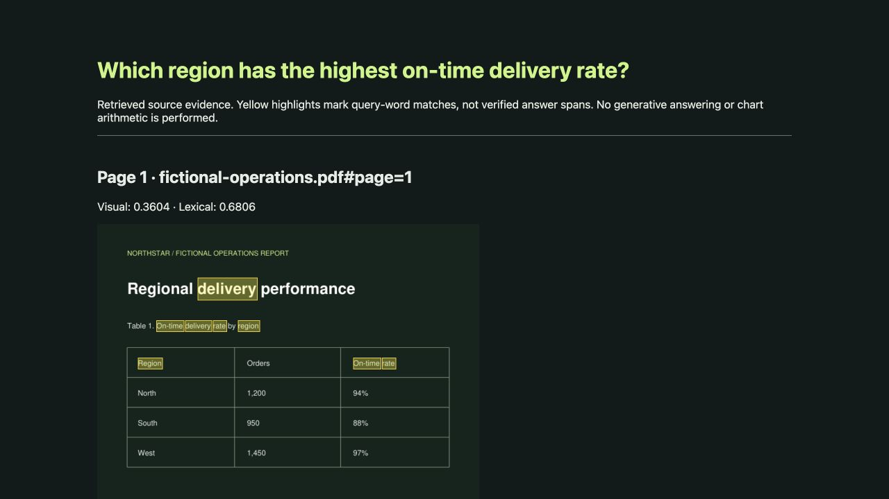
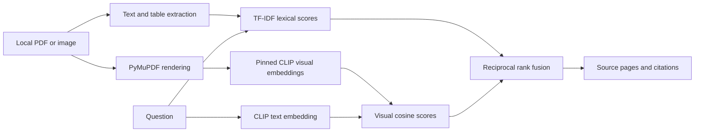

# Multimodal Document Intelligence

A runnable page-level PDF and image retrieval system that compares **text**, **visual CLIP**, and **hybrid** retrieval. It extracts PDF text and ruled tables, embeds rendered pages, and generates a self-contained evidence viewer with page citations and query-word highlights.

This extends the original local document assistant. The original `app.py` remains the small lexical-answer dashboard; this module is the separate multimodal workflow.



## Run

From the repository root, in a Python 3.10+ environment:

```sh
pip install -r requirements-multimodal.txt
python -m multimodal.index index fixtures/fictional-operations.pdf
python -m multimodal.index query "Which region has the highest on-time delivery rate?" --mode hybrid --report reports/my-evidence.html
python -m multimodal.evaluate
```

Open `reports/my-evidence.html` in a browser. The HTML embeds its source-page images and needs no server. Yellow rectangles mark overlapping query words, **not independently verified answer spans**. To index your own local PDF or PNG/JPEG, supply its path to the index command. The index is limited to 50 PDF pages and stored under ignored `local-index/`; do not commit private documents or derived indexes.

The first execution downloads the pinned CLIP checkpoint from Hugging Face. CPU inference is supported; expect a model download of several hundred MB. There is no paid API or remote document upload. The original text-only dashboard does not require these optional dependencies.

## Architecture



## Measured fixture results

| Method | Recall@1 | Mean reciprocal rank |
|---|---:|---:|
| Text | 1.000 | 1.000 |
| Visual | 0.833 | 0.917 |
| Hybrid | 0.833 | 0.917 |

These are actual measured page-retrieval results over **six questions and three fictional pages**. Text retrieval wins on this easy, text-rich fixture. The checked-in JSON report records every question and retrieved page. It does not establish broad document understanding quality.

## What this version does and does not do

- Supports image-only page retrieval through visual embeddings, but performs no OCR on raster images.
- Extracts ruled tables into structured rows and bounding boxes; complex table layouts may fail.
- Returns source evidence with page identifiers. It does not generate answers, reason over numeric charts, or perform table arithmetic.
- CLIP is a general-purpose image/text model with a short text context and low-resolution image processing. It is a baseline for document retrieval, not a specialized document vision model.
- Top-ranked results are always returned. There is no calibrated answerability threshold in this multimodal module; the original lexical assistant has separate abstention behavior.
- Hybrid fusion can degrade results; both favorable and unfavorable results are published.

## Reproducibility

The checkpoint revision is pinned in `index.py`; the index manifest stores the source SHA-256 and checkpoint revision. `build_fixture.py` reproduces the fictional PDF contents. PDF file bytes may vary across generation times, so each index records its own digest. Optional runtime versions are pinned in `requirements-multimodal.txt`.

The next meaningful evaluation should use scanned pages, image-only figures, harder near-duplicate distractors, and independently labeled questions. Reference: [Transformers CLIP documentation](https://huggingface.co/docs/transformers/model_doc/clip).
